# SessionVisualizer

A native Mac app that keeps every Claude Code session and shows what happened in it.

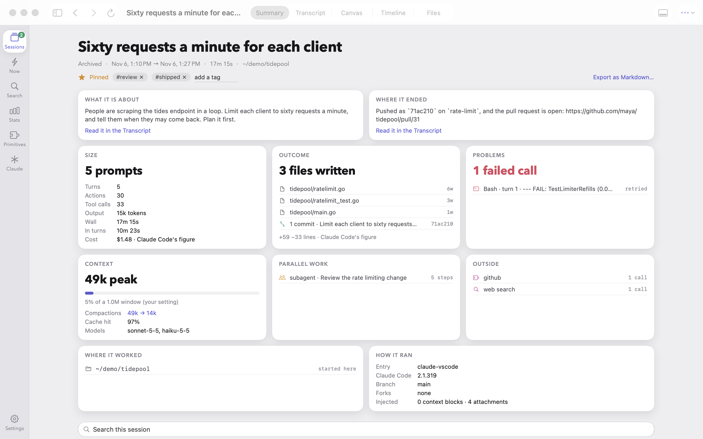

Claude Code writes a transcript of every session and, by default, deletes it after 30 days. SessionVisualizer keeps a
lossless copy on your Mac and turns each session into something you can read: a summary, the transcript, a canvas of how
the work branched, a timeline of where the time went, and the files it touched. It searches across all of them, by words
or by meaning, and shows what every running session is doing right now.

It comes with `skit`, the same engine as a command line tool, with `--json` on every command for scripts and agents.

Nothing leaves your machine. It is free and open source, and it is not made by or affiliated with Anthropic.

> **Before 1.0.** Everything on this page works today, but there is no download yet: for now you
> [build it from source](#install). A signed, notarised download is what 1.0 adds. Apple silicon Macs only, macOS 14 or
> later. It is shared as it comes, without warranty.

## What is in it

### What is running now

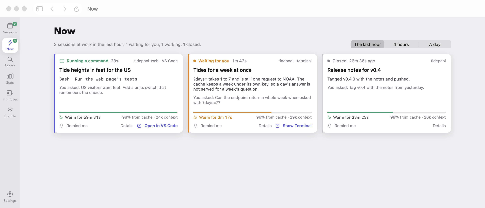

A card for every session at work: what it is doing at this moment, whether it is waiting for you, and a countdown to
when its prompt cache expires. One click brings the editor window or terminal that runs it to the front.

### One session, five ways

The Summary is the picture at the top. The other four:

<table>
  <tr>
    <td width="50%" valign="top">
      <a href="docs/launch/screenshots/transcript.png">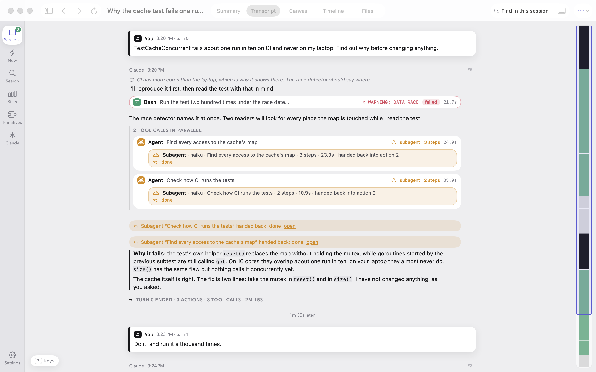</a>
      <br><b>Transcript.</b> The conversation, with tool calls, subagents and thinking folded where you want them.
    </td>
    <td width="50%" valign="top">
      <a href="docs/launch/screenshots/canvas.png">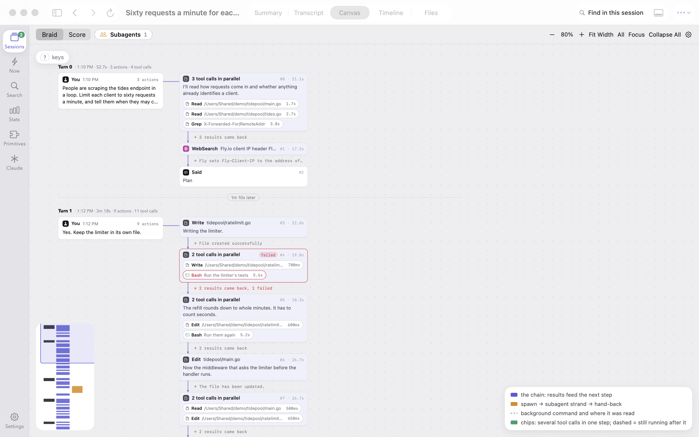</a>
      <br><b>Canvas.</b> The session as a braid of prompts, steps, parallel calls and subagents, or
      <a href="docs/launch/screenshots/canvas-score.png">laid out in time</a>.
    </td>
  </tr>
  <tr>
    <td width="50%" valign="top">
      <a href="docs/launch/screenshots/timeline.png">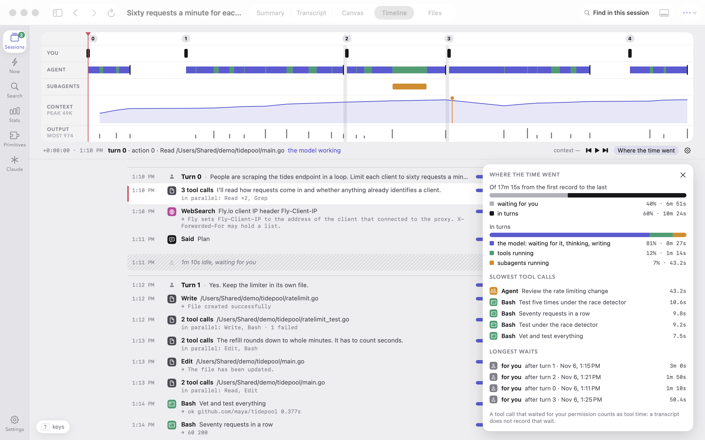</a>
      <br><b>Timeline.</b> Where the wall time went: the model, tools, subagents, waiting for you.
    </td>
    <td width="50%" valign="top">
      <a href="docs/launch/screenshots/files.png">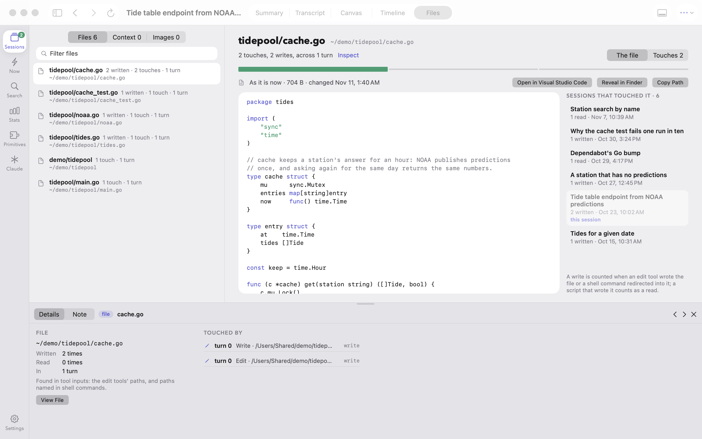</a>
      <br><b>Files.</b> Every file the session touched, as it is now, with every other session that touched it.
    </td>
  </tr>
</table>

### Every session together

<table>
  <tr>
    <td width="50%" valign="top">
      <a href="docs/launch/screenshots/sessions.png">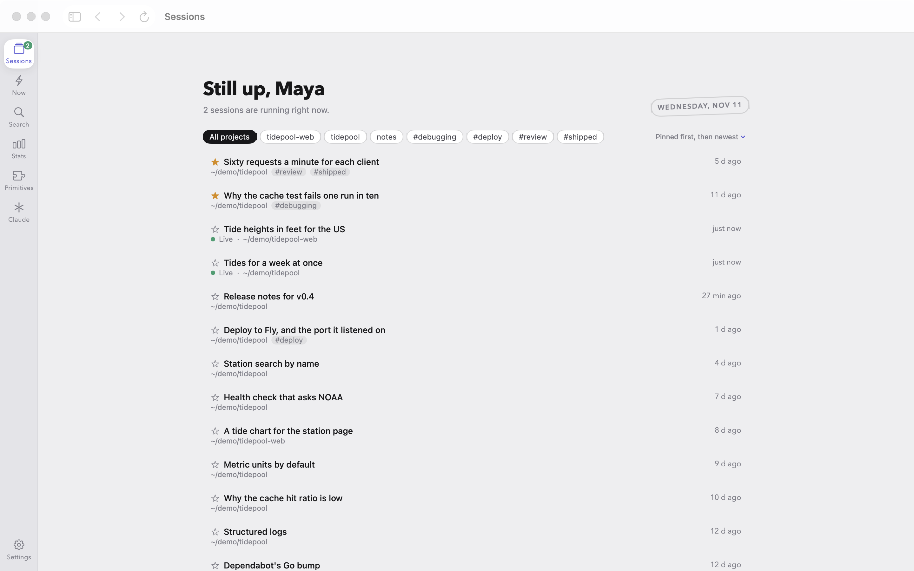</a>
      <br><b>Sessions.</b> Everything kept, including what Claude Code has since deleted. Pin, tag and note what matters.
    </td>
    <td width="50%" valign="top">
      <a href="docs/launch/screenshots/search.png">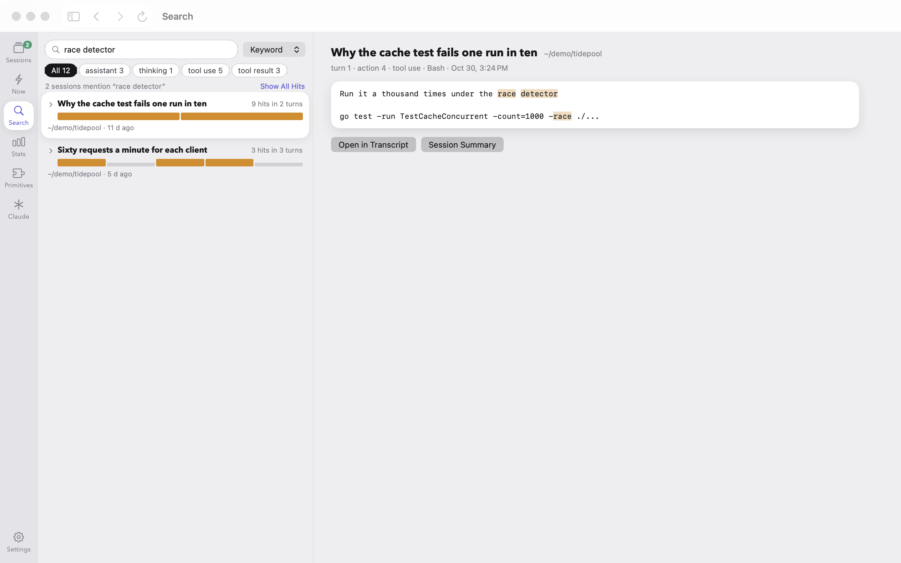</a>
      <br><b>Search.</b> Across every session. By words at once; by meaning with a model that runs on your Mac.
    </td>
  </tr>
  <tr>
    <td width="50%" valign="top">
      <a href="docs/launch/screenshots/stats.png">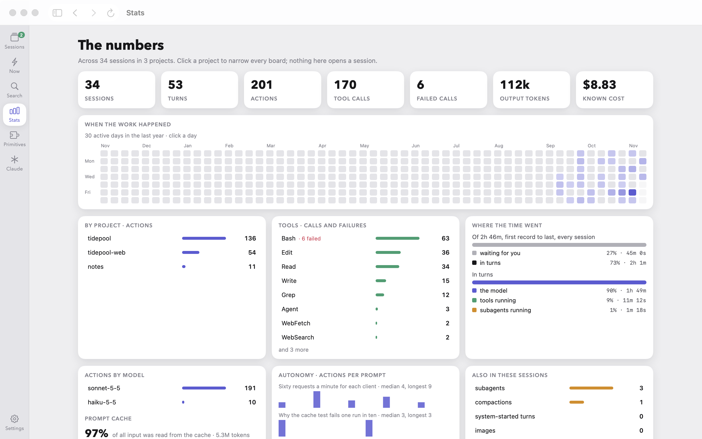</a>
      <br><b>Stats.</b> A year of days, tools and failures, models, the prompt cache, actions per prompt.
    </td>
    <td width="50%" valign="top">
      <a href="docs/launch/screenshots/primitives.png">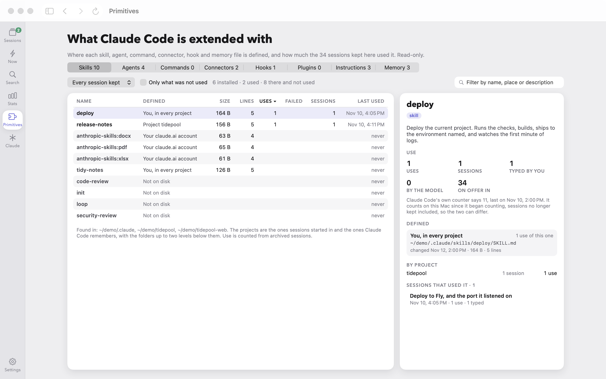</a>
      <br><b>Primitives.</b> Skills, agents, connectors, hooks: where each is defined, how much it is used, what never is.
    </td>
  </tr>
</table>

Every picture here is of made-up sessions. [`docs/launch/`](docs/launch/README.md) has all of them and the script that
takes them.

## What it touches

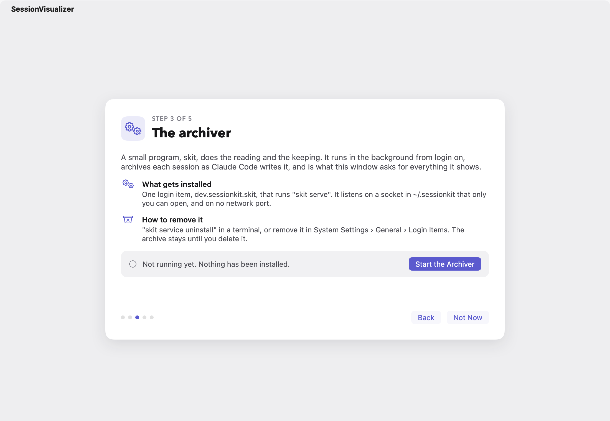

The first run says all of this before the app does any of it.

- **It reads Claude Code's files and never writes them.** Nothing under `~/.claude` is changed. It does not start,
  resume or steer sessions.
- **It keeps its own copy in `~/.sessionkit/`:** each transcript as plain JSONL under zstd (`zstd -dc <file>` gives it
  back without this tool) and a SQLite index. The archive never ends up holding less than it did.
- **It installs one background program,** a login item that runs `skit serve`. It copies each session before Claude Code
  can delete it, whether or not the app is open, and it is what the app talks to. Nothing is installed until you press
  the button.
- **It does not use the network.** No account, no telemetry, no update check. The engine listens on a Unix socket, not a
  port. The one exception is yours to start: search by meaning downloads its model once (about 310 MB, checksum
  verified).

Transcripts hold file contents, command output and, by accident, secrets. So does the archive; it is readable by your
user alone. [`PRIVACY.md`](PRIVACY.md) lists exactly what is read, what is stored and what is sent; the
[questions and answers](docs/launch/faq.md) cover the rest.

## Install

Until 1.0 there is no download, so this builds the app on your Mac. You need an Apple silicon Mac on macOS 14 or later,
[Go](https://go.dev/dl/) 1.26 or later, Swift 6.2 or later (Xcode, or only the Command Line Tools:
`xcode-select --install`) and [just](https://github.com/casey/just) (`brew install just`).

```sh
git clone https://github.com/juan7732/claude-code-session-visualizer
cd claude-code-session-visualizer
just client-app-install   # builds the app, with skit inside, into /Applications
just install              # optional: skit for your terminal, in ~/go/bin
```

Open SessionVisualizer from /Applications. The first run walks through what it reads and keeps, then starts the archiver
when you press the button. The sessions Claude Code still has are archived soon after.

**Search by meaning** is optional. It needs `llama-server` (`brew install llama.cpp`) and one run of `skit embed`, which
downloads the model and gives what is archived its vectors. After that the archiver keeps them current.

**To remove it:**

```sh
skit service uninstall    # stop the archiver and remove its login item
rm -rf /Applications/SessionVisualizer.app
rm -rf ~/.sessionkit      # the archive: every session it kept
```

Leave the last line out to keep the sessions; the archive is plain files and does not need the app to be read.

Without `skit` in your terminal, the one inside the app does the same:
`/Applications/SessionVisualizer.app/Contents/Helpers/skit service uninstall`.

## The command line

Everything the app shows comes from `skit`, and everything `skit` prints is also JSON.

```sh
skit doctor                  # what it can see on this Mac; does the archiver run
skit list -n 10              # the ten most recent sessions
skit show 36086585           # one session as a timeline, by id or unique prefix
skit search retention sweep  # turns across every archived session
skit now                     # what running sessions are doing
skit export 36086585         # a session as Markdown
```

For an agent: every read command takes `--json`, errors are JSON on stderr when it is set, and `skit describe` prints a
manifest of every command and flag. The same operations are served over HTTP on a Unix socket:

```sh
curl --unix-socket ~/.sessionkit/skit.sock http://skit/v0/status
curl --unix-socket ~/.sessionkit/skit.sock 'http://skit/v0/search?q=retention+sweep'
```

<details>
<summary>Every command</summary>

```
skit doctor                    where Claude Code keeps sessions, retention setting, live sessions, disk use, index size,
                               whether the background agent runs and how many sessions still wait to be archived
skit projects                  projects (start directories) that have sessions
skit list [-p slug] [-n N]     sessions, most recent first, with prompts, requests, tool calls, tokens, cost, title
skit show <id> [--turn N]      one session as a timeline grouped by turn; --turn N prints an agent turn with all its
                               actions and tool results, --action N one action, --thinking adds thinking text;
                               --context adds injected prompt blocks and every attachment Claude Code added
skit export <id> [--turn N]    the session, or one turn, as Markdown: what was asked, what was said, one line per tool call
skit stats <id> [--context]    tokens once per request (subagents rolled in), models, tools, compactions, context curve
skit time <id> [--top N]       where the wall time went: waiting for you or for background work against in turns; in turns
                               the model, tools, subagents, waiting for a hand-back; slowest calls, longest waits
skit context <id> [--action N] what the model received for an action: system prompt, tool definitions, messages (CLAUDE.md
                               labelled), injected attachments, each with size, next to the reported token counts; --show prints one;
                               --compaction N explains a compaction: before, summary sections, preserved, re-injected, after
skit relations <id>            the links a transcript does not state: background commands and where their output was read,
                               subagent hand-backs, retried calls, files, web hosts, skills and connectors reached, API errors
skit images <id> [--extract N] the images pasted into prompts or returned by tools; --extract N writes one out
skit file <path> [--session id] a file some session touched: there or gone, and every session that read or wrote it;
                               --text prints it. Only files a session touched are ever read
skit annotate <id>             pin, tag or note a session (--pin, --tag, --note turn:3='…'); with no flags, show what is there
skit overview [-p text]        every session added up from the index: totals, by project, by day, tools, models, time
skit now [--minutes N]         sessions at work: what each is doing at this moment (the model, a tool, waiting for you),
                               and when its prompt cache expires; reads the end of each transcript, never all of it
skit primitives [kind [name]]  skills, agents, commands, connectors, hooks, plugins, memory files: where each is defined,
                               how much the archived sessions used it, what is there and never used; --days N, --unused
skit claude [--root dir]       how Claude Code is set up here, read-only: each settings layer and the value that wins,
                               experiments, feature flags, memory files, skills; keys and tokens are never printed
skit archive [id...]           copy sessions losslessly into ~/.sessionkit/archive (raw JSONL, zstd) and index them for search;
                               --verify checks every copy against the index and changes nothing
skit search <words> [--kind K] find turns across archived sessions; a query of ids or codes weighs exact words more;
                               --mode meaning ranks by what the text says, shared words or not (after `skit embed`), and
                               says so when nothing is close; --mode hybrid lists those first and the keyword hits after;
                               --session, --project, --kind, --no-tools narrow any mode
skit embed                     give archived prose vectors for meaning search, with EmbeddingGemma 2 in a local
                               llama-server; the first run downloads the model once (310 MB, checksum verified)
skit eval <queries.json>       measure search against queries whose answers are known: R@1, R@5, R@10, MRR per mode
skit serve [--socket P]        the same operations over HTTP on a Unix socket (/v0/…); watches ~/.claude and archives
skit service install           keep `skit serve` running from login on (a launchd agent), so sessions are archived
                               without being asked; `service status`, `service uninstall`
skit describe                  machine-readable manifest of every command and flag (for agents)
```

`<id>` is a session id, a unique prefix, or the path to a `.jsonl` transcript. `list`, `show` and `stats` keep working
from the archive after Claude Code has deleted the source. `list` reads indexed summaries from
`~/.sessionkit/skit.sqlite` when a transcript has not changed (`--no-cache` to bypass). If a transcript shrinks or is
replaced, the fuller copy stays beside the new one as `<copy>.prev-<time>`
([ADR 0008](docs/decisions/0008-the-archive-never-shrinks.md)). Search by meaning is described in
[`docs/meaning-search.md`](docs/meaning-search.md).

</details>

## How it is built

One engine, several faces. `sessionkit` is a Go engine that reads, archives, indexes and searches; `skit` is its command
line; `skit serve` is the same operations over a Unix socket; SessionVisualizer is a SwiftUI app that talks only to that
socket and never parses a transcript itself. The command line came first on purpose: whatever the app can show, an agent
can ask for.

| Path                        | What                                                                 |
| --------------------------- | -------------------------------------------------------------------- |
| `cmd/skit`, `internal/cli`  | The command line: parse, call the engine, print.                     |
| `sessionkit/`               | The engine: transcripts, stats, the archive, search, the service.    |
| `client/SessionVisualizer/` | The Mac app, a Swift package with no dependencies.                   |
| `test/integration/`         | The end-to-end suite: the real binary in a throwaway home.           |
| `docs/`                     | The source of truth: tenets, principles, the plan, what was decided. |

Where to read next:

- [`docs/tenets.md`](docs/tenets.md): the beliefs that settle trade-offs here, in priority order.
- [`docs/architecture.md`](docs/architecture.md) and [`docs/design-principles.md`](docs/design-principles.md): how it is
  put together and why.
- [`docs/plan-v0.md`](docs/plan-v0.md): what is done and what is next.
- [`docs/`](docs/README.md): everything else, including what is known about Claude Code's transcript format.

## Contributing

Bug reports and fixes are welcome. [`CONTRIBUTING.md`](CONTRIBUTING.md) says how to build and test, what a change needs,
and what must never be committed (anyone's real sessions).

## License

[MIT](LICENSE). Claude and Claude Code are trademarks of Anthropic; this project is independent of it.
